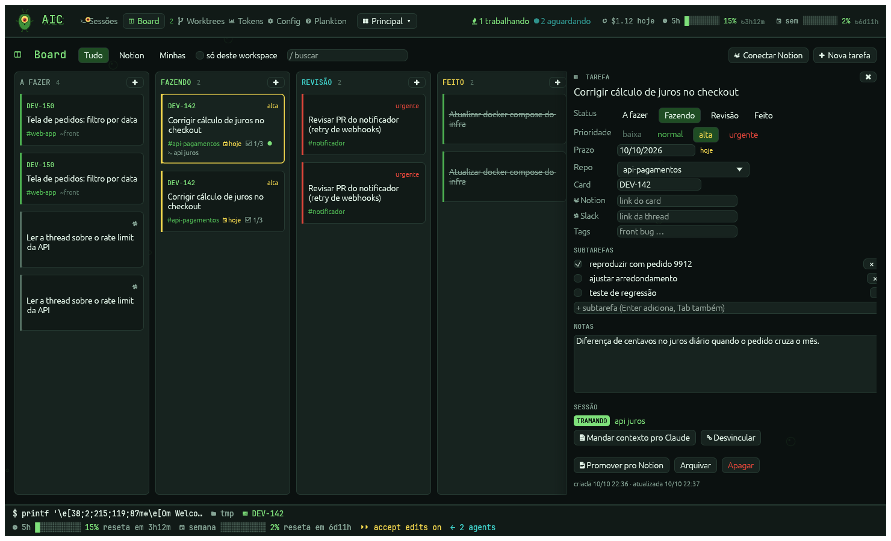
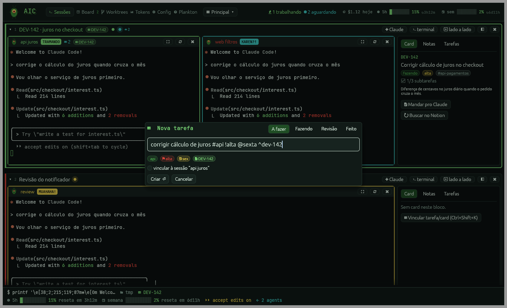
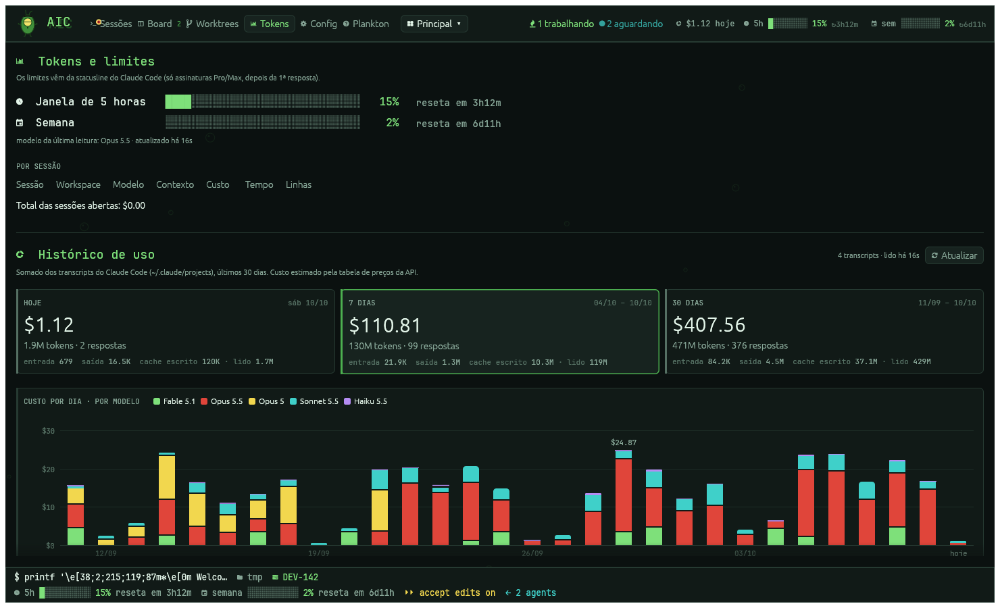

# AIC

> down in a hole, up in the stack

Uma central desktop para quem trabalha com vários [Claude Code](https://claude.com/claude-code) ao mesmo tempo. Substitui o tmux: cada contexto de trabalho (um card, um bug, uma ideia) vira um **bloco** com seus terminais, notas, tarefas e o card do Notion, e o AIC mostra de relance quem está trabalhando, quem terminou e quem precisa de você.

Feito em Rust com [egui](https://github.com/emilk/egui). Roda no Linux (X11 e Wayland).


## O que faz

- **Blocos**: terminais (Claude ou shell), notas em Markdown, tarefas e card agrupados por contexto. Quatro visualizações: blocos, abas, foco e grade.
- **tmux por baixo**: os terminais rodam num servidor tmux próprio. Fechou a janela, o app caiu? Os Claudes continuam rodando e o AIC reconecta ao abrir.
- **Estado de cada sessão** pelos hooks do Claude Code: trabalhando, esperando você, terminou, morreu. Um atalho pula para a próxima que precisa de você; som e notificação avisam quando termina.
- **Tecla líder** (padrão `Ctrl+Space`): mostra um menu com todos os atalhos, como o prefixo do tmux, só que exibindo as opções.
- **Captura rápida**: uma linha vira tarefa, com marcadores (`#repo @hoje !alta ^DEV-142`).
- **Abrir card**: cole o link de um card e o AIC monta o bloco com um worktree e um Claude por repositório.
- **Board** kanban com tarefas locais e cards do Notion, **worktrees** por card e uma aba de **tokens** com limites da conta e custo por sessão.
- **Módulos**: tudo além dos terminais liga e desliga.
- **Dois temas**: **AIC** (padrão, inspirado no grunge de Seattle) e **Plankton** (do Bob Esponja), cada um com mascote animado, variantes de cor e nomes próprios para os estados.

| | |
| --- | --- |
|  |  |
| Board no tema Plankton | Captura rápida |



## Instalação

Precisa de `git`, um compilador C (`build-essential` no Debian/Ubuntu), `tmux` e o Claude Code. O resto o instalador resolve, sem sudo.

```bash
git clone https://github.com/viniciuscg/AIC.git ~/AIC
cd ~/AIC
./install.sh
```

O `install.sh` pode rodar quantas vezes quiser; cada passo diz `ok`, `feito` ou `pulado`:

1. instala o Rust com o rustup se não houver `cargo` (sem mexer no seu `PATH`);
2. compila (`cargo build --release`);
3. cria o link `~/.local/bin/aic`;
4. instala os ícones e o atalho no menu (`~/.local/share/applications/aic.desktop`);
5. liga o plugin do Claude: `~/.local/share/aic/plugin` → `claude/` do repo;
6. baixa os sons que não podem ir no repositório;
7. instala a fonte JetBrainsMono Nerd Font Mono se ela não estiver no sistema;
8. avisa se faltar `tmux` ou `claude`.

```bash
./install.sh --dry-run     # mostra o que faria
./install.sh --uninstall   # remove binário, atalho, ícones, link do plugin, sons e fonte
```

Para atualizar: `git pull && ./install.sh`.

## Uso

```bash
aic                          # abre o app
aic --tema plankton          # abre com outro tema
aic --fresh                  # começa sem reabrir as sessões salvas
aic add "revisar PR #api !alta @amanha"   # cria tarefa pelo terminal
aic tasks [--all] [--json]   # lista tarefas
aic done <id>                # conclui
```

Na primeira vez, um assistente pergunta a visualização, o tema, as pastas dos seus repositórios, a tecla líder e os módulos.

### Blocos e visualizações

`Ctrl+Shift+Enter` cria um bloco, `Ctrl+Shift+N` abre um Claude nele (escolhendo pasta ou worktree), `Ctrl+Shift+T` abre um shell ao lado. `Ctrl+Shift+V` troca a visualização:

| Visualização | Como fica |
| --- | --- |
| Blocos | cada bloco com seus terminais, um embaixo do outro |
| Abas | um bloco por aba, terminais divididos; o jeito tmux |
| Foco | um terminal grande e a lista de sessões ao lado |
| Grade | todos os terminais do workspace numa grade |

Para usar os atalhos do app com o terminal em foco, solte o teclado com `Ctrl+Shift+Esc` (ou use a tecla líder). `Ctrl+Shift+A` vai para a próxima sessão que precisa de você; `Alt+1..9` pula para o bloco N; `Ctrl+Shift+P` abre a paleta de comandos.

### Captura rápida

`Ctrl+Shift+Space` abre a captura rápida. Os marcadores podem estar em qualquer posição:

```text
corrigir cálculo de juros #api !alta @hoje +sprint ^DEV-142 ~backend
```

| Marcador | Vira |
| --- | --- |
| `#repo` | repositório (por prefixo: `#api` → `api-pagamentos`) |
| `@hoje` `@sexta` `@12/10` | prazo |
| `!alta` `!!` `!!!` `!baixa` | prioridade |
| `+workspace` | workspace |
| `^DEV-142` | card do Notion |
| `~tag` | etiqueta livre |

Dentro de uma sessão aberta pelo AIC, `/aic:tarefa texto` cria a tarefa já vinculada à sessão.

### Abrir card

`Ctrl+Shift+J`, cole o link do card. O AIC cria um worktree por repositório (`<repo>.worktrees/<branch>`, branch com o nome do card), abre um Claude em cada, um shell e as notas. O plugin `aic` dá ao Claude as skills para puxar o contexto do card e da thread do Slack, quebrar o trabalho entre repositórios e fechar a entrega.

### tmux por baixo

O AIC sobe um servidor tmux só dele, com config própria em `~/.local/share/aic/tmux.conf` (sem barra nem atalhos, invisível). O seu tmux e o seu `~/.tmux.conf` não são tocados. Dá para desligar no módulo **Persistência (tmux)**.

### Sons

Ao terminar uma sessão o AIC toca um som (e, se quiser, outro quando ela pede permissão). Há sons **sintetizados** pelo próprio app (acorde grunge, microfonia, sino, pop), os **baixados** pelo `install.sh` e qualquer `.mp3/.ogg/.wav` que você puser em `~/.local/share/aic/sounds/`.

### Módulos

Em Config → Módulos, globalmente ou por tema: tmux, workspaces, abrir card, board, notas, worktrees, tokens, Notion, Slack, barra de status, dicas de atalho, mascote, fundo animado, som e notificações.

O manual completo, com todos os atalhos, fica dentro do app (`F1`) e em [`skins/aic/HELP.md`](skins/aic/HELP.md).

## Configuração

| Arquivo | O quê |
| --- | --- |
| `~/.config/aic/config.toml` | preferências (tema, visualização, fonte, módulos, sons…). Tudo tem padrão; o app grava nele pela tela de Config. |
| `~/.config/aic/keybinds.toml` | seus atalhos (`acao = "Ctrl+Shift+N"`, vazio desliga) |
| `~/.config/aic/.env` | tokens e ids das integrações (veja abaixo) |
| `~/.local/share/aic/` | banco de dados, sons, plugin, tmux.conf |
| `~/.local/state/aic/` | eventos dos hooks e snapshots da statusline |

### `.env`

Opcional. Copie o modelo e preencha só o que usar:

```bash
mkdir -p ~/.config/aic
cp .env.example ~/.config/aic/.env
chmod 600 ~/.config/aic/.env
```

| Variável | Para quê |
| --- | --- |
| `NOTION_TOKEN` | token de integração do Notion (só para o conector "Token") |
| `AIC_NOTION_TASKS_DB` | id da database de cards |
| `AIC_NOTION_SPRINTS_DB` | id da database de sprints |
| `AIC_NOTION_ME` | você no Notion (e-mail ou id), para "só meus cards" |
| `AIC_NOTION_KEY_PREFIX` | prefixo da chave dos cards (ex: `DEV`) |
| `AIC_REPOS_DIRS` | pastas com repositórios, separadas por `:` (aceita `~`) |
| `SLACK_WORKSPACE_URL` | URL do workspace do Slack |

O arquivo é lido ao abrir o app; variáveis que já estão no ambiente têm prioridade sobre ele, e ele tem prioridade sobre o `config.toml`.

Notion e Slack funcionam de dois jeitos: pelo **conector Claude** (padrão: usa os conectores já ligados na sua conta do Claude, sem token) ou pelo **conector Token** (API direta do Notion, mais rápido).

## Desenvolvimento

```bash
cargo run -p aic-app                         # roda do código
cargo test --workspace                       # testes
cargo test -p aic-app --test snapshots       # renderiza as telas sem janela em target/snapshots/
```

Estrutura: `crates/aic-core` (modelo, store SQLite, captura rápida, git, Notion, uso), `crates/aic-term` (terminal embutido), `crates/aic-app` (UI, temas, CLI), `claude/` (plugin do Claude Code), `skins/` (manuais dos temas).

Para criar um tema, copie `crates/aic-app/src/skins/template.rs`, ajuste e registre em `skins::all()`.

## Créditos

- O terminal embutido (`crates/aic-term`) é derivado do [egui_term](https://github.com/Harzu/egui_term) (MIT, © 2024 Ilia Shvyrialkin; licença em [`crates/aic-term/LICENSE-egui_term`](crates/aic-term/LICENSE-egui_term)), sobre o [alacritty_terminal](https://github.com/alacritty/alacritty).
- O tema AIC é só **inspirado** no grunge de Seattle e em Alice in Chains: desenho, mascote e sons sintetizados são originais, sem logos, capas ou gravações da banda. Não há relação com a banda.
- O tema Plankton é uma homenagem de fã ao personagem de *Bob Esponja* (Nickelodeon); o desenho é original. O gemido do Plankton é baixado pelo `install.sh` de um site público de efeitos sonoros e não faz parte do repositório.
- Fonte recomendada: [JetBrainsMono Nerd Font](https://www.nerdfonts.com/) (OFL).

## Licença

[MIT](LICENSE) © Vinicius Gonçalves
