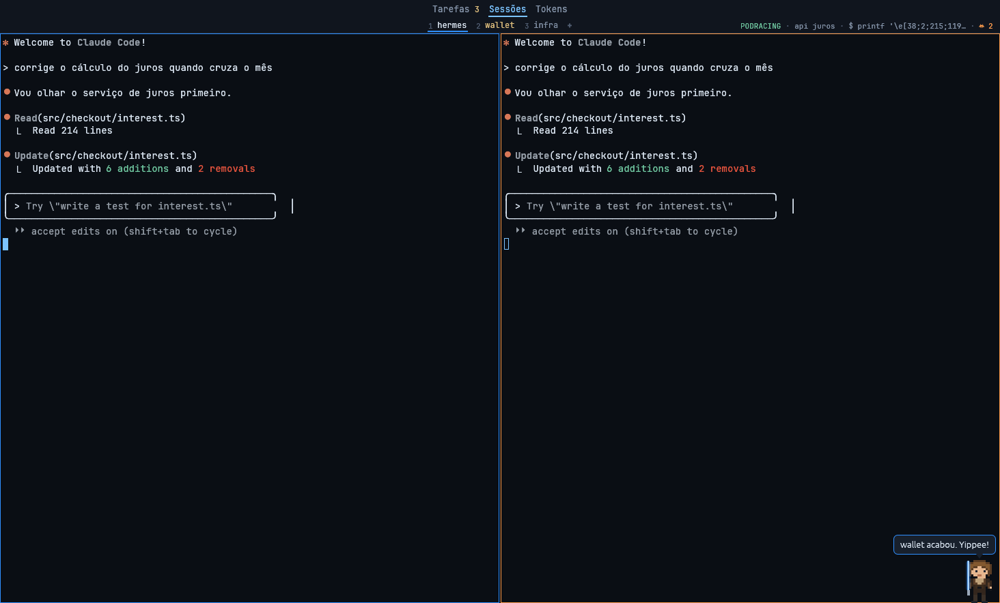
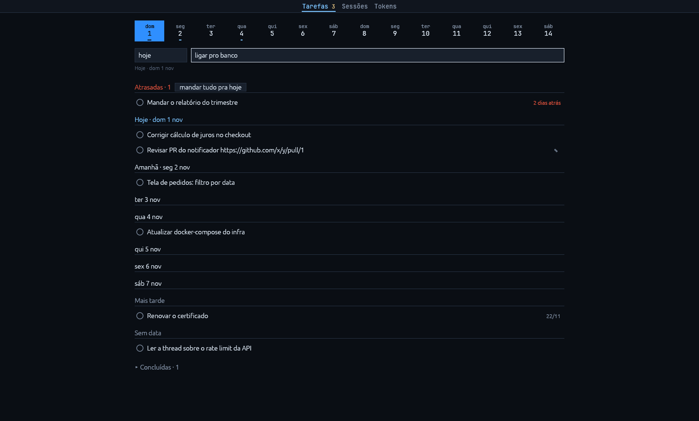

# Anakin

> now this is podracing

Uma central desktop para quem trabalha com vários [Claude Code](https://claude.com/claude-code) ao mesmo tempo, no jeito do i3: a janela é quase toda terminal, com Tarefas, Sessões e Tokens centralizados em cima. `Ctrl+Tab` anda entre os três. O comando é `aic`.

Feito em Rust com [egui](https://github.com/emilk/egui). Roda no Linux (X11 e Wayland).



## O que faz

- **Sessões e terminais**: cada contexto (hermes, wallet…) é uma sessão na barra, com seus terminais divididos. Fechar um terminal fecha só ele.
- **Só terminal na tela**: sem cabeçalhos. O estado, o modelo, o contexto, a branch e o custo do terminal em foco ficam ao lado das sessões. Toda dica de mouse diz a tecla.
- **Tarefas à parte**: uma aba no jeito do "Próximos" do Todoist, com data e tarefa agrupadas por dia, sem ligação com as sessões.
- **tmux por baixo**: os terminais rodam num servidor tmux próprio. Fechou a janela, o app caiu? Os Claudes continuam rodando e ele reconecta ao abrir.
- **Estado de cada sessão** pelos hooks do Claude Code. Quando acaba, toca um sabre de luz e a notificação cita a sessão: "hermes acabou".
- **Prefixo estilo tmux** (`Ctrl+B`), funcionando com o terminal focado, e um **catálogo de atalhos** (`Ctrl+Space`).
- **Anakin**: um boneco em pixel art no canto da tela, que anda, fala em balões e, no clique, abre um Claude sempre aberto pra criar workspaces, anotar tarefas e abrir sessões, por texto ou voz.
- **Worktrees**, **Changes** (diff e commit) e **Tokens** (limites e custo).
- **Otimizado**: terminal escondido não gasta redesenho, linha que não mudou não é refeita, `git status` só de quem está na tela. `tests/perf.rs` mede.
- **Módulos**: tudo além dos terminais liga e desliga.



## Instalação

Precisa de `git`, um compilador C (`build-essential` no Debian/Ubuntu), `tmux` e o Claude Code. O resto o instalador resolve, sem sudo.

```bash
git clone https://github.com/viniciuscg/AIC.git ~/AIC
cd ~/AIC
./install.sh
```

O `install.sh` pode rodar quantas vezes quiser; cada passo diz `ok`, `feito` ou `pulado`:

1. instala o Rust com o rustup se não houver `cargo` (sem mexer no seu `PATH`);
2. compila (`cargo build --release`);
3. cria o link `~/.local/bin/aic`;
4. instala os ícones e o atalho no menu (`~/.local/share/applications/aic.desktop`);
5. liga o plugin do Claude: `~/.local/share/aic/plugin` → `claude/` do repo;
6. instala a fonte JetBrainsMono Nerd Font Mono se ela não estiver no sistema;
7. voz do Anakin: se não houver `whisper-cli`, compila o whisper.cpp em `~/.local/share/aic/whisper.cpp` (com `cmake` ou, sem ele, `uvx cmake`) e baixa o modelo `ggml-small.bin` (~470 MB). Pulado se a transcrição estiver configurada como API ou comando;
8. avisa se faltar `tmux` ou `claude`.

```bash
./install.sh --dry-run     # mostra o que faria
./install.sh --uninstall   # remove binário, atalho, ícones, link do plugin, fonte e whisper.cpp
```

Para atualizar: `git pull && ./install.sh`.

## Uso

```bash
aic                          # abre o app
aic --fresh                  # começa sem reabrir as sessões salvas
aic add "revisar PR @amanha"  # cria tarefa pelo terminal
aic tasks [--all] [--json]   # lista tarefas
aic done <id>                # conclui
aic ws new 'Pessoal' --go    # workspaces e sessões no app aberto (veja Anakin)
aic voz                      # liga/desliga a gravação pro Anakin
```

Na primeira vez, um assistente pergunta os módulos, as pastas dos seus repositórios, o prefixo e a tecla do catálogo.

O manual completo, com todos os atalhos, fica dentro do app (`F1`) e em [`docs/MANUAL.md`](docs/MANUAL.md).

### O essencial

| Tecla | Ação |
| --- | --- |
| `Ctrl+Tab` ou `Alt+Tab` | próxima aba: Tarefas → Sessões → Tokens |
| `Alt+1..9`, `Ctrl+Alt+→ ←` | sessão N, próxima / anterior |
| `Ctrl+B B` | nova sessão |
| `Ctrl+B c` / `%` | novo Claude / shell nesta sessão |
| `Ctrl+B x` | fecha o terminal em foco |
| `Ctrl+B &` | fecha a sessão inteira |
| `Ctrl+B t` | tarefas, já escrevendo uma nova |
| `Ctrl+B z` | maximiza o terminal |
| `Ctrl+B a` | próxima que precisa de você |
| `Ctrl+B ?` | todos os atalhos |

## Configuração

| Arquivo | O quê |
| --- | --- |
| `~/.config/aic/config.toml` | preferências (prefixo, fonte, módulos, som…). Tudo tem padrão; o app grava nele pela tela de Config. |
| `~/.config/aic/keybinds.toml` | seus atalhos (`acao = "Ctrl+Shift+N"`, vazio desliga) e as teclas do prefixo (tabela `[prefix]`) |
| `~/.config/aic/.env` | pastas de repositórios e chaves da transcrição (veja abaixo) |
| `~/.local/share/aic/` | banco de dados (sessões, notas, tarefas), sons, plugin, tmux.conf |
| `~/.local/state/aic/` | eventos dos hooks e snapshots da statusline |

### `.env`

Opcional. Copie o modelo e preencha só o que usar:

```bash
mkdir -p ~/.config/aic
cp .env.example ~/.config/aic/.env
chmod 600 ~/.config/aic/.env
```

| Variável | Para quê |
| --- | --- |
| `AIC_REPOS_DIRS` | pastas com repositórios, separadas por `:` (aceita `~`) |
| `OPENAI_API_KEY` / `GROQ_API_KEY` | transcrição de voz do Anakin por API |

O arquivo é lido ao abrir o app; variáveis que já estão no ambiente têm prioridade sobre ele, e ele tem prioridade sobre o `config.toml`.

## Desenvolvimento

```bash
cargo run -p aic-app                         # roda do código
cargo run --release -- --fresh               # sem reabrir as sessões salvas
cargo test --workspace                       # testes
cargo test -p aic-app --test snapshots       # renderiza as telas sem janela em target/snapshots/
cargo test --release -p aic-app --test perf -- --ignored --nocapture --test-threads=1   # custo por frame
```

Estrutura: `crates/aic-core` (modelo, store SQLite, git, uso), `crates/aic-term` (terminal embutido), `crates/aic-app` (UI, visual em `brand.rs`, CLI), `claude/` (plugin do Claude Code), `docs/MANUAL.md` (o manual que aparece no app).

## Créditos

- O terminal embutido (`crates/aic-term`) é derivado do [egui_term](https://github.com/Harzu/egui_term) (MIT, © 2024 Ilia Shvyrialkin; licença em [`crates/aic-term/LICENSE-egui_term`](crates/aic-term/LICENSE-egui_term)), sobre o [alacritty_terminal](https://github.com/alacritty/alacritty).
- Projeto de fã, sem relação com a Lucasfilm ou a Disney. O visual e os nomes são só **inspirados** em Star Wars: o desenho, o ícone e o som (sintetizado) são originais, sem imagens ou gravações dos filmes.
- Fonte recomendada: [JetBrainsMono Nerd Font](https://www.nerdfonts.com/) (OFL).

## Licença

[MIT](LICENSE) © Vinicius Gonçalves
